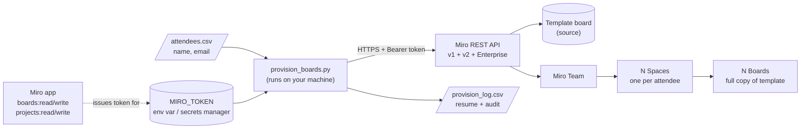
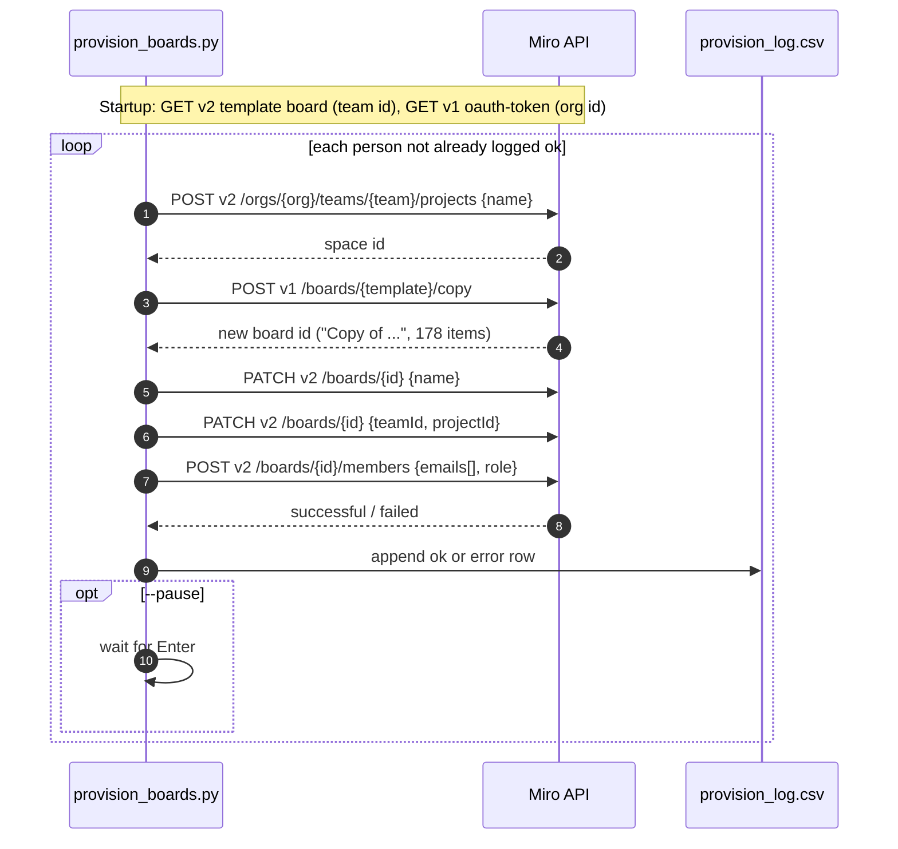
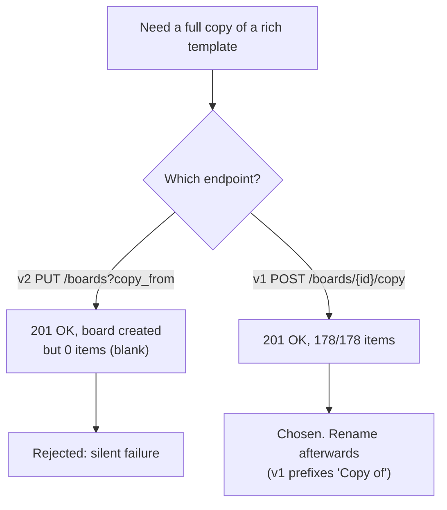
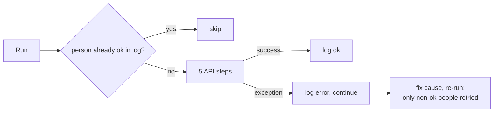
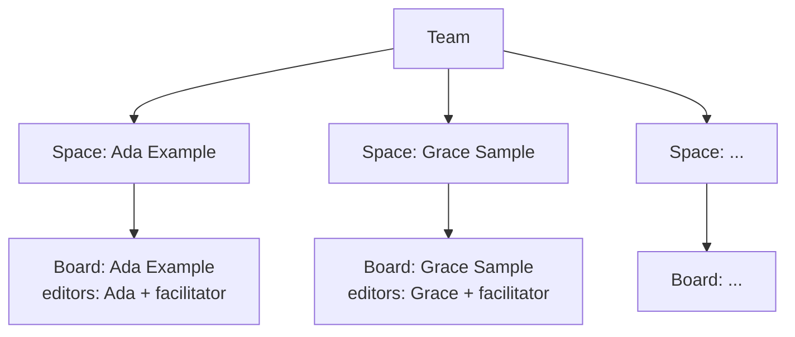

# Architecture

GitHub renders the Mermaid diagrams below natively.

## 1. System context

## 2. Per-attendee sequence

## 3. Why v1 for the copy

## 4. Error handling and resumability

## 5. Final state

